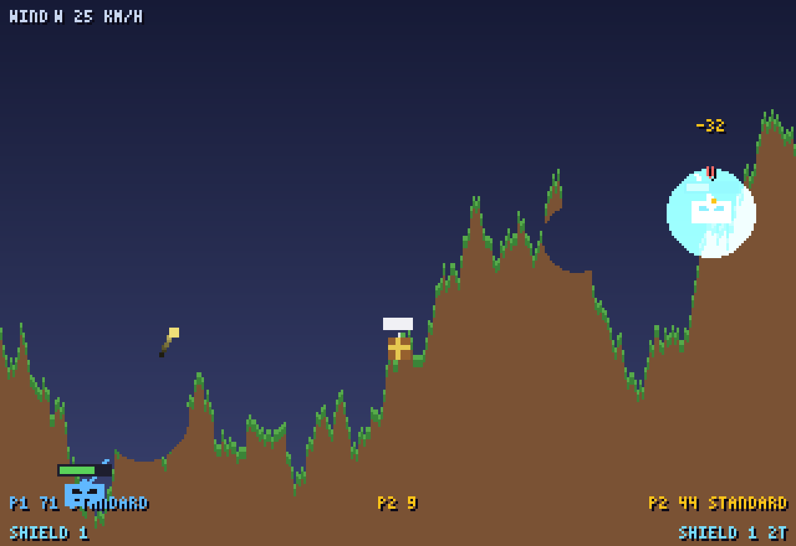

# STRIKE-19

A 2-player local artillery game for **Batocera Linux** arcade cabinets, written in Python 3 +
pygame.



## Controls

Each arcade controller is a separate device (the first = Player 1, second = Player 2).
Actions are mapped as: **A** fire/charge, **B** weapon select, **X/Y** shield, stick/D-pad
to aim (horizontal) and fine-aim (vertical), **START** start, **BACK+START** (or Esc) exit.

Keyboard fallback for desktop testing:

| Action  | Player 1 | Player 2 |
|---------|----------|----------|
| Aim     | `A` / `D` | `←` / `→` |
| Fine aim| `W` / `S` | `↑` / `↓` |
| Fire    | `F`      | `K`      |
| Weapon  | `G`      | `L`      |
| Shield  | `H`      | `J`      |

`START` = Enter or `1`, mode toggle = any aim key on the menu, exit = Esc.

## Modes

- **Classic** — alternating turns, 15-second turn clock.
- **Brawl** — both players fire at will.

## Build & test

```bash
pip install -r requirements.txt                  # pygame-ce
python3 build_sounds.py                          # regenerate sounds/ (rarely needed)
python3 strike-19.pygame --windowed             # play on the desktop
python3 tests/smoke_test.py                      # self-checks + headless play-through
```

`tests/smoke_test.py` exercises the pure logic and plays a scripted round with the SDL dummy
driver (no display, no audio, no external deps), so it works over SSH on the cabinet too.

## Deploy to a Batocera cabinet

Copy the project folder to `roms/pygame/strike-19/` on the Batocera
share, then add a gamelist entry (or run "Update gamelists" on the box). Batocera runs the
`.pygame` file directly with its bundled pygame.
